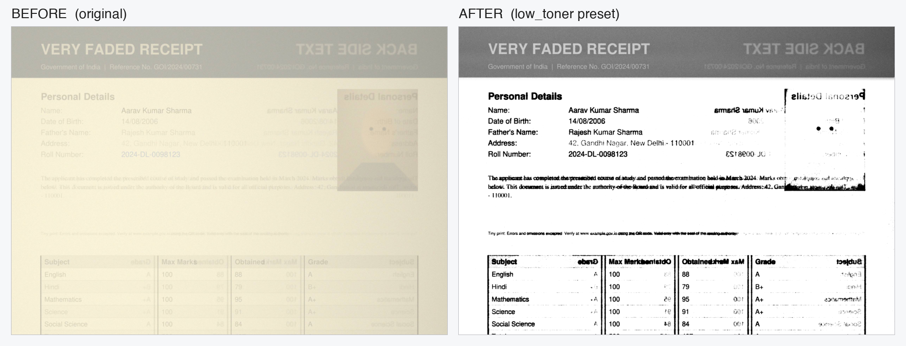
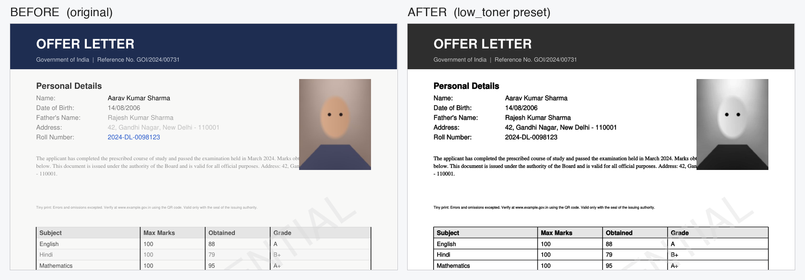
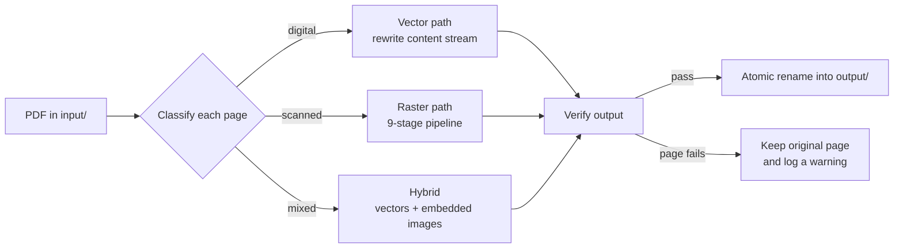

<div align="center">

# 🖨️ PDF Printer Optimizer

**Make faint, grey and faded PDFs print crisp and readable, even on a printer that is running out of toner.**

[](https://www.python.org/)
[](https://pymupdf.readthedocs.io/)
[](https://opencv.org/)
[](#-quick-start)
[](LICENSE)

Drop PDFs in a folder, pick how dark you want them, and get print-ready copies with the **same file names**.
Your originals are never touched.

</div>



---

## 📌 Table of contents

- [Why this exists](#-why-this-exists)
- [What it does](#-what-it-does)
- [Quick start](#-quick-start)
- [Using the tool](#-using-the-tool)
- [How it works](#-how-it-works)
- [Engineering highlights](#%EF%B8%8F-engineering-highlights)
- [Configuration](#%EF%B8%8F-configuration)
- [Testing](#-testing)
- [Troubleshooting](#%EF%B8%8F-troubleshooting)
- [Project structure](#-project-structure)
- [Limitations and roadmap](#%EF%B8%8F-limitations-and-roadmap)

---

## 💡 Why this exists

A laser printer can only do two things at any point on the page: put toner down, or leave the
paper white. It fakes grey by printing a pattern of tiny dots (a *halftone*).

That causes real problems:

| Problem | What you see on paper |
|---|---|
| **Low toner cartridge** | Halftone dots fade first. Grey text, light labels and thin table lines simply **disappear**, while solid black still prints. |
| **Faded or yellowed scans** | Old certificates, receipts and photocopies come out as a muddy grey page. |
| **Modern "designer" PDFs** | Light grey labels, thin hairline borders and coloured text look fine on screen but print pale. |
| **Bulk documents** | Fixing pages one by one in an image editor is slow, and it destroys selectable text. |

Buying a new cartridge or re-scanning everything is not always an option. This tool fixes the
**document** instead, so whatever toner is left goes where it matters.

---

## ✨ What it does

- **Batch processing.** Every PDF in `input/` (including sub-folders) goes to `output/`, keeping the same name and folder layout.
- **Interactive menu.** Choose darkness, resolution, colour mode and page handling with a number key. No config editing needed.
- **Four darkness presets**, from a gentle cleanup up to `low_toner`, which makes every piece of text and every line solid 100% black.
- **Smart page classification.** Each page is detected as *digital*, *scanned* or *mixed* and gets a different treatment:
  - **Digital pages stay vector.** Text remains sharp and selectable; only colours and line widths are rewritten.
  - **Scanned pages** are rebuilt at up to 1200 DPI through a 9-stage image pipeline.
- **Protects what shouldn't be darkened:** photos, QR codes, barcodes, signatures, stamps, seals, watermarks, and white text on dark bars.
- **Safe by design.** It checks a SHA-256 hash of each original before and after processing. Outputs are written atomically and verified by two independent PDF parsers.
- **Fast.** PDFs are processed in parallel, and the number of workers is chosen from your CPU count *and* available memory.
- **Clear reporting.** You get a summary table, a detailed log and before/after preview images.

### Digital PDF: grey and coloured text becomes solid black, still vector



*Grey labels, light-grey address text and blue links become solid black. The photo keeps its tones,
the header bar keeps its white text, and the diagonal watermark stays light.*

---

## 🚀 Quick start

**Requirements:** Python 3.9 or newer ([download](https://www.python.org/downloads/); on Windows tick *"Add Python to PATH"*).

```bash
git clone https://github.com/erpiyushkr/pdf-printer-optimizer.git
cd pdf-printer-optimizer
```

Then pick one:

| System | How to run |
|---|---|
| **Windows** | Double-click **`run.bat`** |
| **macOS** | Double-click **`run.command`** (the first time: right-click → Open) |
| **Any** | `pip install -r requirements.txt` then `python main.py` |

On first use, the launchers create a private Python environment (`.venv`) and install the
dependencies automatically. This needs an internet connection once.

---

## 🧭 Using the tool

1. **Copy your PDFs into `input/`.** Photos and scanned images (JPG, PNG, TIFF, BMP, WebP) work too: each is placed on an A4 page, enhanced and saved as a PDF with the same name.
2. **Run the tool.** A short menu appears. Type a number and press Enter, or press Enter to keep the current choice:

```text
================================================================
                    PDF PRINTER OPTIMIZER
================================================================
PDFs waiting in the input folder: 2

1. How dark should the content be?
----------------------------------------------------------------
  1) Normal
        Balanced. Clean background, text moderately darker.
  2) Strong
        Grey text and thin strokes noticeably darker.
  3) Maximum readable
        All text near black, faint ink strongly boosted.
  4) Low toner (darkest)  <- current
        Everything solid black and slightly bolder. Best when the
        cartridge is running low and light content disappears.
Choose 1-4 [Enter = 4]:
```

   The four questions are:

   | Question | Choices |
   |---|---|
   | Darkness | Normal · Strong · Maximum readable · **Low toner** |
   | Resolution for scanned pages | 300 · 400 · 600 · **800** · 1200 DPI |
   | Colour mode | **Grayscale** · Black & white only |
   | Page handling | **Automatic** · Treat every page as a scan |

   You then confirm (**Start / Change / Quit**). You can also save your choices as the new default.

3. **Collect the results from `output/`** and print them.

```text
Total PDFs found:        24
Successfully processed:  21
Failed:                  2
Skipped:                 1
Total time:              17.3 s

Filename              Status    DPI      Pages     Time       Size
------------------------------------------------------------------
Aadhaar Card.pdf      SUCCESS   800          1     3.3s     3.6 MB
Class 10th.pdf        SUCCESS   vector       1     0.1s    24.2 KB
Password Protected... SKIPPED   -            -     0.0s          -
```

In the **DPI** column, `vector` means the page stayed digital (sharp, selectable text). A number means the page was a scan and was rebuilt at that resolution.

### Darkness presets

| Preset | Best for |
|---|---|
| `normal` | Balanced cleanup: clean background, moderately darker text |
| `strong` | Noticeably darker grey text and thin strokes |
| `maximum_readable` | All text near black; faint ink strongly boosted |
| `low_toner` **(default)** | Weak cartridges. All text and lines become **solid black**, vector text gets a slight bold, and hairlines are at least 0.8 pt. |

### Command line (for power users and scripts)

```bash
python main.py --preset low_toner --dpi 600     # skip the menu, use these settings
python main.py --mode monochrome                # pure black & white output
python main.py --input "D:\Scans" --output "D:\Print"
python main.py --workers 1 --no-preview         # low-memory computers
python main.py --no-menu                        # run with config.json settings
```

The menu is skipped automatically when setting flags are given or when the tool isn't run in a
terminal, so it works in scripts and scheduled tasks.

### 🖨️ Tips for a weak cartridge

Combine `low_toner` with these printer settings (the names are HP LaserJet's; other brands are similar):

- Turn **EconoMode / Toner Save** off.
- Raise **Print Density** to 4–5.
- Use the highest quality setting (e.g. *FastRes 1200*).
- Take the cartridge out and rock it gently 5–6 times to spread the remaining toner.
- For text-only scans, try **Black & white only**, which leaves no grey dots at all.

---

## 🔬 How it works



### Digital pages: content-stream rewriting
Instead of rasterizing (which would blur text and make files huge), the tool parses each page's
PDF **content stream** operator by operator and tracks the graphics state (colour spaces, line
width, transformation matrix, transparency, text render mode).

- **Text and line colours** in RGB, CMYK, grey and ICC-based colour spaces are mapped to darker greys, or to solid black with `low_toner`.
- **Hairlines** are widened to a printable minimum, compensating for the transformation matrix's scale.
- **Faux bold:** text is switched to *fill + stroke* render mode (`2 Tr`) with a thin outline of the same colour. Letters get thicker without changing fonts or layout.
- **Context awareness:** the background behind each text span is sampled, so white text on a dark header stays white. Watermarks (transparent, huge or rotated text) and large fills are left alone.
- **Form XObjects** (reusable sub-drawings) are rewritten only once each.

### Scanned pages: the raster pipeline

| # | Stage | Purpose |
|---|---|---|
| 1 | **Illumination correction** | Estimates a paper-only background map to remove yellowing, shadows and scanner gradients |
| 2 | **Edge-preserving denoise** | A guided filter removes paper grain without softening strokes |
| 3 | **Unsharp masking** | Restores edge crispness |
| 4 | **Adaptive tone mapping** | A 2-D lookup table on *(pixel darkness × strongest ink nearby)*. Grey text near black text becomes black, and a page that is faded all over is stretched to full contrast. |
| 5 | **Coherence gate** | Measures the noise floor locally (about every 0.5″, with sigma clipping) and removes isolated speckles while keeping faint but continuous strokes |
| 6 | **Controlled stroke growth** | Fractional, DPI-aware erosion thickens thin letters without filling in their counters |
| 7 | **Table-line reinforcement** | Morphological detection of long, thin, straight lines, which are thickened without affecting text |
| 8 | **Solid-black snapping** | Turns near-black ink into pure black so the printer prints it solid, not as halftone dots |
| 9 | **Protected regions** | Photos get CLAHE and a gentle gamma; QR codes and barcodes get mild tone mapping; signatures and stamps are darkened gently but never denoised or thickened; shaded boxes keep their fill |

Any invisible OCR text layer is kept, so scanned PDFs stay searchable.

---

## 🏗️ Engineering highlights

| Area | Detail |
|---|---|
| **Data safety** | It never writes to `input/`. It hashes each original with SHA-256 before and after processing. Output is written to a temp file and renamed into place only after verification. |
| **Output verification** | Every output is reopened with **PyMuPDF and pypdf**. The checks are page count, each page's size, and the raster DPI. |
| **Fault isolation** | If one page fails, the original page is kept. If one document fails, the batch continues. Corrupt and password-protected files are reported, not crashed on. |
| **Memory-aware parallelism** | `ProcessPoolExecutor` with a worker count based on CPU cores and total RAM, given the per-page buffer size at the chosen DPI. Large images are processed in row strips. |
| **Robust statistics** | Paper and noise levels are estimated with iterative sigma clipping, so faint ink isn't mistaken for paper. |
| **Cross-platform** | One codebase on Windows, macOS and Linux, with double-click launchers that bootstrap their own virtual environment. |
| **Configurable, not hard-coded** | Every stage can be switched on or off in `config.json`, and the values are validated with friendly error messages. |

**Tech stack:** Python · PyMuPDF (PDF parsing, rendering, content streams) · OpenCV (image processing, QR and barcode detection) · NumPy · Pillow · pypdf

---

## ⚙️ Configuration

The menu covers everyday choices. Everything else lives in [`config.json`](config.json):

| Setting | Values | Meaning |
|---|---|---|
| `darkness_level` | `normal`, `strong`, `maximum_readable`, **`low_toner`** | Darkening strength |
| `target_dpi` | 300, 400, 600, **800**, 1200 | Resolution for scanned pages |
| `output_mode` | **`grayscale`**, `monochrome` | Monochrome means pure black and white, with much smaller files |
| `mixed_page_mode` | **`hybrid`**, `rasterize` | Whether mixed pages keep vector text |
| `force_rasterize_all_pages` | true / **false** | Treat every page as a scan |
| `contrast_enhancement`, `adaptive_contrast`, `background_cleanup`, `denoise`, `sharpening`, `faint_text_enhancement`, `thin_line_enhancement` | true / false | Turn individual pipeline stages on or off |
| `sharpening_strength`, `denoise_strength`, `background_cleanup_strength` | `"auto"` or 0.0–2.0 | Fine-tune a stage |
| `min_line_width_pt` | `"auto"` or points | Minimum width for vector lines |
| `preserve_photographs`, `preserve_qr_codes`, `preserve_barcodes`, `preserve_signatures`, `preserve_stamps`, `preserve_seals` | true / false | Protected regions |
| `raster_compression`, `jpeg_quality` | `jpeg` / `lossless`, 50–100 | Output size vs. fidelity |
| `workers` | `"auto"` or a number | PDFs processed in parallel |
| `overwrite_output`, `include_subfolders`, `generate_preview`, `verify_output`, `generate_logs` | true / false | Batch behaviour |

---

## 🧪 Testing

[`tools/make_test_pdfs.py`](tools/make_test_pdfs.py) generates **24 synthetic test documents** covering
the edge cases real users hit:

> digital and scanned pages · heavily faded text · back-side bleed-through · yellowed paper ·
> photos · QR codes and barcodes · stamps and signatures · rotated and landscape pages · CMYK
> colours · OCR text layers · form XObjects · two-up layouts · multi-page reports · an
> encrypted file · corrupt and truncated files

```bash
python tools/make_test_pdfs.py
python main.py --no-menu --input samples --output samples_out
```

These properties were checked on this suite:

- **Results:** 21 succeeded, 2 corrupt files reported as FAILED, and 1 encrypted file SKIPPED, with no crashes.
- **Text:** the extracted text of every digital page is identical before and after (nothing lost or reordered).
- **Page sizes:** all page sizes and orientations are preserved.
- **QR codes:** they still decode after processing.

---

## 🛠️ Troubleshooting

| Symptom | Fix |
|---|---|
| Light content still missing on paper | Keep `low_toner`, choose **Black & white only**, and apply the [printer tips](#%EF%B8%8F-tips-for-a-weak-cartridge) |
| Too dark, or bleed-through from the back of the page shows | Use `maximum_readable`, `strong` or `normal` |
| "worker crashed" / out of memory | Set `"workers": 1` or choose 600 DPI |
| Output files too large | Choose 600 DPI, or **Black & white only** for text documents |
| macOS says `run.command` can't be opened | Right-click → Open the first time |
| A file is SKIPPED as password protected | Remove the password, then run again |

---

## 📁 Project structure

```text
pdf-printer-optimizer/
├── main.py                 # batch runner: CLI, summary table, logging, parallel workers
├── menu.py                 # interactive start-up menu
├── processor.py            # enhancement engine (vector rewriter + raster pipeline)
├── config.json             # all settings, with inline help
├── requirements.txt
├── run.bat                 # Windows launcher (bootstraps .venv)
├── run.command             # macOS/Linux launcher (bootstraps .venv)
├── tools/
│   └── make_test_pdfs.py   # synthetic test-suite generator
├── assets/                 # README images
├── input/                  # ← put your PDFs here
└── output/                 # ← optimized PDFs appear here
```

`logs/` and `previews/` are created on the first run.

---

## 🗺️ Limitations and roadmap

**Known limitations**
- Upscaling cannot invent detail: a 200-DPI scan rendered at 800 DPI is still a 200-DPI scan. The enhancement improves *readability*, and the high DPI only avoids adding new losses.
- With `low_toner`, back-side bleed-through and paper texture in poor scans may become more visible.
- Password-protected PDFs must be unlocked first.

**Ideas for the future**
- A drag-and-drop desktop GUI
- Per-page preset overrides
- An OCR pass that adds a text layer to scans that don't have one
- Packaging as a `pip install`-able command

---

## 📄 License

[MIT](LICENSE). You are free to use, modify and share this project.

<div align="center">

**Built by [Piyush Kumar](https://github.com/erpiyushkr)**. If this saved you a cartridge, consider giving it a ⭐

</div>
